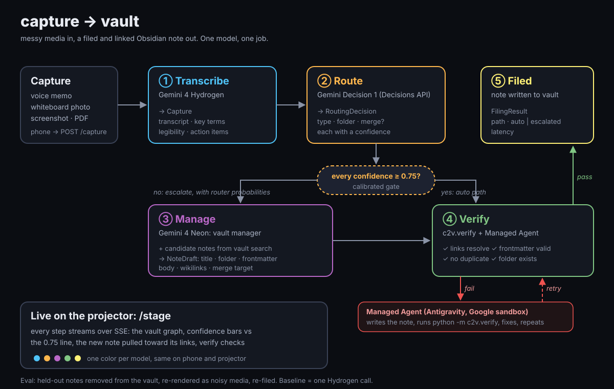

# capture-to-vault

Messy media in, a clean, correctly filed and linked Obsidian note out. Built at the Gemini 4 NYC
Hackathon (Nov 21, 2026) for **Problem Statement 1: 5 Sigma**.

Throw it a voice memo, a whiteboard photo, a handwritten page, a screenshot or a scanned PDF. It
transcribes the capture, decides where the note belongs, links it to the right existing notes, checks
its own work and files it. The UI is a capture page plus the resulting note — not a dashboard, not a
chat box.

## How it works: four models, four jobs



Say it out loud in the demo: **Hydrogen = transcriber**, **Decision 1 = router**, **Neon = vault
manager**, **Managed Agent = verifier**.

| Step | Model | Job |
|---|---|---|
| Transcribe | Gemini 4 Hydrogen | Media to a structured capture (transcript, key terms, legibility) |
| Route | Gemini Decision 1 (Decisions API) | Note type, folder, merge target, each with a calibrated confidence |
| Manage | Gemini 4 Neon | Low-confidence cases: picks links and merges, writes the final markdown |
| Verify | Antigravity Managed Agent | In a sandbox, runs `c2v.verify` on the draft and fixes it until every check passes |

High router confidence (≥ `ROUTE_CONFIDENCE_MIN`, default 0.75) can file without Neon. Low confidence
escalates with the router's probabilities as context. The Managed Agent loop is the “proof it works”
story for the Best use of Managed Agents prize.

## Demo inputs

`demo_captures/` holds ten synthetic, unprepared-looking inputs keyed to `demo_vault/` topics
(EECE 448, job hunt, Batcave, homelab). See [`demo_captures/README.md`](demo_captures/README.md) for
which note each file should land in or link to.

Live walkthrough: [`docs/demo-script.md`](docs/demo-script.md) (~3 minutes). Submission blurb, 1-minute
video shot list, and pre-submit checklist: [`docs/submission.md`](docs/submission.md).

## Results

Live Gemini comparison on 15 notes stratified across folders in a private working copy of the
synthetic `mock_vault/`. The notes were removed before evaluation and rendered as five clean,
five noisy, and five hard captures (screenshots, handwritten-style images, scanned PDFs, and
voice memos). Hard captures include partial text and an ambiguous topic. Both methods saw the
same media and remaining vault. Link F1 is the mean of per-case F1 scores.

| Method | Completed | Folder accuracy | Link F1 | Verify pass | Escalation | Median latency |
|---|---:|---:|---:|---:|---:|---:|
| One-call Hydrogen baseline | 15/15 | 40.0% | 29.0% | 93.3% | — | 6.08s |
| capture-to-vault pipeline | 15/15 | 60.0% | 33.7% | 100.0% | 100.0% | 19.36s |

The pipeline improved folder accuracy by 20 percentage points and link F1 by 4.7 points, at
about 3.2 times the median latency. Every case escalated to Neon; this run therefore does not
demonstrate a fast router-only path. The local verifier and repair loop were included, but the
remote Managed Agent verifier was outside this capped comparison. The run used 61 API calls,
plus three calls to synthesize the voice memos. See [detailed results](eval/results/summary.md).

### Where it still fails

- The clean PHYS 230 voice memo went to the parent academic folder instead of the course folder;
  both methods linked `School` and missed all four expected course links.
- The hard `Fault detection` screenshot was filed under the EECE 410 course rather than
  `40 Knowledge/Concepts`; the pipeline added four unrelated project links where the source
  note had none.
- The noisy `Plant Watering Bot` handwritten capture went to `Sessions/2026-11` instead of
  its project folder, with none of its four expected links. Both methods made the same error.

## Run it
```bash
cp .env.example .env   # add GEMINI_API_KEY
python3 -m venv .venv && . .venv/bin/activate && pip install -r requirements.txt
PYTHONPATH=. python -m c2v.pipeline demo_captures/01_voice_gd_momentum.wav --vault demo_vault
uvicorn app.server:app --host 0.0.0.0 --port 8000   # capture page
```

`demo_vault/` is a small synthetic vault, so the repo contains no personal notes. Point `VAULT_PATH`
at a private copy only for local eval — never commit a real vault or `.env`.

## Give any AI your vault: `get_context` over MCP
One tool gives an agent the right whole notes for a project, conversation or topic. It starts from the
best match, follows wikilinks, backlinks and the `project:`/`parent:` note it belongs to, and packs
whole notes to a token budget. HTTP: `GET /context?q=Solar%20Microgrid%20Capstone&max_tokens=4000`.

```bash
# Claude Code (run from the repo root; use absolute paths)
claude mcp add capture-to-vault -e VAULT_PATH="$PWD/demo_vault" -e PYTHONPATH="$PWD" \
  -- "$PWD/.venv/bin/python" -m c2v.mcp_server

# Gemini CLI
gemini mcp add capture-to-vault -e VAULT_PATH="$PWD/demo_vault" -e PYTHONPATH="$PWD" \
  "$PWD/.venv/bin/python" -m c2v.mcp_server
```
Or in `~/.gemini/settings.json`:
```json
{"mcpServers": {"capture-to-vault": {"command": "/abs/repo/.venv/bin/python",
  "args": ["-m", "c2v.mcp_server"], "cwd": "/abs/repo", "env": {"VAULT_PATH": "/abs/repo/demo_vault"}}}}
```
Tools: `get_context(query, max_tokens)`, `search_notes(query)`, `read_note(title)`. The vault is
re-read on every call, so a capture filed a moment ago is already in context.

## Built during the hackathon
Everything in this repo was written on Nov 21, 2026. Lanes: A pipeline, B eval, C verify + capture
page, D demo inputs + submission docs.
