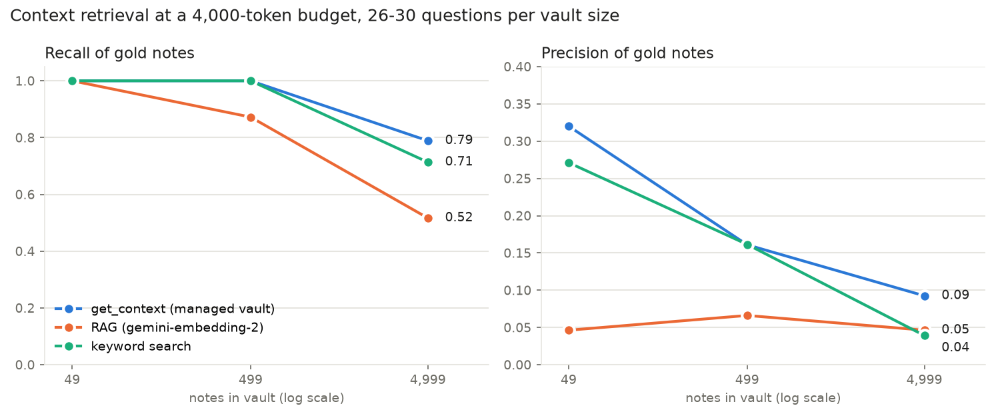

# Scale: managed vault (`get_context`) vs RAG vs keyword search

**The claim we tested:** as a vault grows, similarity search over chunks has to guess, while
structured retrieval over a filed, linked vault stays accurate.

**What the numbers say:** mostly yes, with one clear exception.
- At 5,000 notes, `get_context` keeps the most gold notes: recall 0.79, vs 0.71 for keyword search and
  0.52 for RAG.
- On questions about the vault's structure (decisions, roundups, project status), the gap is wider:
  0.88 vs 0.57 vs 0.67.
- On exact-detail lookups ("latency 269ms?"), plain keyword search wins outright: 1.00 at every size,
  vs 0.60 for `get_context` and 0.20 for RAG.

## Results (4,000-token budget, tokens = chars/4 for every system)

| vault notes | system | n q | recall | precision | tokens returned | notes returned | p50 latency ms |
|---|---|---|---|---|---|---|---|
| 49 | RAG | 26 | 1.00 | 0.05 | 3357 | 49.0 | 272 |
| 49 | keyword | 26 | 1.00 | 0.27 | 1534 | 20.7 | 1 |
| 49 | get_context | 26 | 1.00 | **0.32** | **606** | 7.9 | 1 |
| 499 | RAG | 30 | 0.87 | 0.07 | 3975 | 36.4 | 277 |
| 499 | keyword | 30 | 1.00 | 0.16 | 3480 | 30.8 | 10 |
| 499 | get_context | 30 | 1.00 | 0.16 | 2663 | 23.6 | 3 |
| 4,999 | RAG | 30 | 0.52 | 0.05 | 3984 | 36.2 | 308 |
| 4,999 | keyword | 30 | 0.71 | 0.04 | 3966 | 45.0 | 99 |
| 4,999 | get_context | 30 | **0.79** | **0.09** | 3831 | 23.8 | 375 |

Recall at 4,999 notes, by question type:

| question type (n) | RAG | keyword | get_context |
|---|---|---|---|
| decision: "What did I decide about X for P?" (7) | 1.00 | 0.71 | **1.00** |
| roundup: "Give me everything about C." (7) | 0.40 | 0.25 | **1.00** |
| status: "What's the latest on P?" (6) | 0.61 | **0.78** | 0.61 |
| keyword-style detail lookup (10) | 0.20 | **1.00** | 0.60 |

All per-type rows for every size are in `scale/results/tables.md`. Raw per-question rows, with gold
and returned titles, are in `scale/results/rows_rag_keyword_get_context.jsonl`.

## Takeaway

As the vault grows from 50 to 5,000 notes, RAG's recall falls from 1.00 to 0.52. `get_context` falls
only to 0.79, and on structural questions it stays at 0.88 with about 2× the precision of either
baseline. Following links and backlinks finds every note in a "decision" or "everything about"
answer, while similarity search fills the budget with near-duplicates ("Loss aversion basics",
"… cheat sheet") and with other projects' sessions on the same topic. It is not a clean sweep:
`get_context` ties RAG on "latest on project" (it doesn't rank sessions by date) and loses to its own
keyword fallback on exact-detail lookups, which are fixable ranking issues, not limits of the approach.

## Setup

- **Vaults:** `scale/make_vaults.py` grows mock_vault's layout procedurally to 49, 499 and 4,999
  notes. It uses no API calls and is deterministic.
  - **Near-duplicate names:** concept variants such as "Kalman filter basics" and "Advanced Kalman
    filter", and project variants such as "Homelab Server v2" and "(old)".
  - **Overlapping terms:** decision topics and concepts are shared across projects.
  - **Stale sessions:** earlier sessions whose decision was later marked superseded.
- **Questions:** `scale/questions.py` writes 26–30 questions per size, with gold sets derived from
  the structure:

  | Type | Gold notes |
  |---|---|
  | decision | latest session on that topic + project note |
  | roundup | concept + every note linking to it (2–8 gold) |
  | status | project note + its 2 newest sessions |
  | keyword (1/3 of the set) | the one session with a unique measured detail |

- **RAG:** each note is split into chunks of at most 500 tokens and embedded with
  `gemini-embedding-2` at 768 dimensions, using the documented retrieval prefixes (`title: … | text: …`
  for documents, `task: search result | query: …` for queries;
  [docs](https://ai.google.dev/gemini-api/docs/embeddings)). Retrieval takes the top chunks by cosine
  similarity until the budget is used. RAG latency includes the query-embedding API call, about
  270 ms.
- **keyword:** `Vault.search` ranking, packing whole notes until the budget is used.
- **get_context:** `c2v.context.get_context` as merged to main.
- **Cost:** 5,258 chunks embedded once, about 756K tokens, about $0.15. Embeddings are cached in
  `bench/cache/embeddings/` and gitignored, so reruns are free.
- **Reproduce:** `python -m bench.scale.make_vaults && python -m bench.scale.questions &&
  python -m bench.scale.run_scale && python -m bench.scale.report`

## Limitations

**The vault is synthetic, and its structure comes from our own pipeline's conventions.** Every
session has a `project:` link and logs back into its project note, so the graph that `get_context`
walks is complete and correct by construction. A real vault, where links are missing or wrong, will
narrow the gap. The gold sets for decision, roundup and status questions come from that same link
structure. That favors structural retrieval, and it is the claim under test, not a neutral measure.

**Session text is templated and semantically thin.** "Decision: use SQLite instead of Postgres for
the cache policy" doesn't give embeddings much to work with. RAG would likely do better on rich prose
and on paraphrased questions, and this set has no paraphrased questions. Our "keyword-style" third
turned out to favor exact lexical match, not semantic similarity.

**The sample is small** (6–10 questions per type per size), and one embedding model was tested at
one dimension.

**Precision is low for every system** because all three fill the 4,000-token budget. Read it as how
much noise is in the context, not as a ranking score.

**`get_context` latency grows with vault size** (375 ms at 5K notes, likely from rebuilding
backlinks on every call). That is worth caching before the demo.
