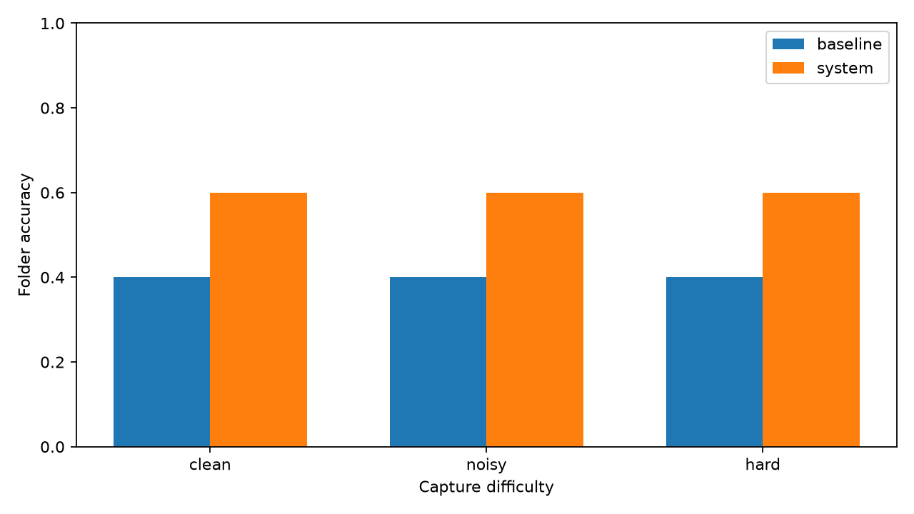

# Held-out evaluation

Dataset: mock vault held-out copy. Scores include completed cases only; errors are reported separately.

| Method | Done / attempted | Folder acc | Link P | Link R | Link F1 | Verify pass | Escalation | Median latency |
|---|---:|---:|---:|---:|---:|---:|---:|---:|
| baseline | 15 / 15 | 40.0% | 23.9% | 53.3% | 29.0% | 93.3% | — | 6.08s |
| system | 15 / 15 | 60.0% | 30.0% | 57.8% | 33.7% | 100.0% | 100.0% | 19.36s |

## Failures by capture

| Method | Media kind | Runs | Failures |
|---|---|---:|---:|
| baseline | handwritten | 3 | 3 |
| baseline | scanned_pdf | 4 | 2 |
| baseline | screenshot | 5 | 2 |
| baseline | voice_memo | 3 | 2 |
| system | handwritten | 3 | 2 |
| system | scanned_pdf | 4 | 0 |
| system | screenshot | 5 | 2 |
| system | voice_memo | 3 | 2 |

## Failures by difficulty

| Method | Difficulty | Runs | Failures |
|---|---|---:|---:|
| baseline | clean | 5 | 3 |
| baseline | hard | 5 | 3 |
| baseline | noisy | 5 | 3 |
| system | clean | 5 | 2 |
| system | hard | 5 | 2 |
| system | noisy | 5 | 2 |

## Worst cases

- h002 (baseline, handwritten): wrong folder; missed or extra links
- h004 (baseline, voice_memo): wrong folder; missed or extra links
- h006 (baseline, screenshot): wrong folder; missed or extra links
- h004 (system, voice_memo): wrong folder; missed or extra links
- h007 (baseline, scanned_pdf): wrong folder; missed or extra links; verify: empty_body

