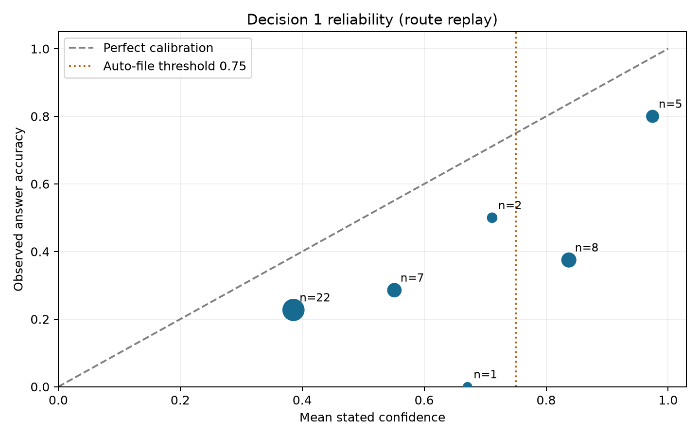

# Held-out evaluation

Dataset: mock vault held-out copy. Scores include completed cases only; errors are reported separately.

| Method | Done / attempted | Folder acc | Link P | Link R | Link F1 | Verify pass | Escalation | Median latency |
|---|---:|---:|---:|---:|---:|---:|---:|---:|
| baseline | 15 / 15 | 40.0% | 23.9% | 53.3% | 29.0% | 93.3% | — | 6.08s |
| system | 15 / 15 | 60.0% | 30.0% | 57.8% | 33.7% | 100.0% | 100.0% | 19.36s |

## Failures by capture

| Method | Media kind | Runs | Failures |
|---|---|---:|---:|
| baseline | handwritten | 3 | 3 |
| baseline | scanned_pdf | 4 | 2 |
| baseline | screenshot | 5 | 2 |
| baseline | voice_memo | 3 | 2 |
| system | handwritten | 3 | 2 |
| system | scanned_pdf | 4 | 0 |
| system | screenshot | 5 | 2 |
| system | voice_memo | 3 | 2 |

## Failures by difficulty

| Method | Difficulty | Runs | Failures |
|---|---|---:|---:|
| baseline | clean | 5 | 3 |
| baseline | hard | 5 | 3 |
| baseline | noisy | 5 | 3 |
| system | clean | 5 | 2 |
| system | hard | 5 | 2 |
| system | noisy | 5 | 2 |

## Worst cases

- h002 (baseline, handwritten): wrong folder; missed or extra links
- h004 (baseline, voice_memo): wrong folder; missed or extra links
- h006 (baseline, screenshot): wrong folder; missed or extra links
- h004 (system, voice_memo): wrong folder; missed or extra links
- h007 (baseline, scanned_pdf): wrong folder; missed or extra links; verify: empty_body

## Is Decision 1's confidence trustworthy?

A separate route-only replay on the same 15 captures recorded all 45 Decision 1 answers (note type, folder, merge target). The original pipeline run saved only whether it escalated, so these confidence values are from a replay. Gold note types map the source note's frontmatter to the router's categories; all held-out notes have `new` as the merge target because their source notes were removed from the eval vault.

Expected calibration error (ECE): **24.5%** across 45 answers. Lower is better; zero is perfect. The model was overconfident in this small sample.

| Confidence bin | Answers | Mean confidence | Accuracy |
|---|---:|---:|---:|
| 0.0–0.5 | 22 | 38.6% | 22.7% |
| 0.5–0.6 | 7 | 55.1% | 28.6% |
| 0.6–0.7 | 1 | 67.1% | 0.0% |
| 0.7–0.8 | 2 | 71.1% | 50.0% |
| 0.8–0.9 | 8 | 83.7% | 37.5% |
| 0.9–1.0 | 5 | 97.4% | 80.0% |

At the 0.75 minimum-confidence threshold, **0/15** cases qualified for auto-file, so auto-file accuracy is undefined. The other **15/15** escalated; their replay router folder accuracy was **20.0%**. The actual pipeline run also escalated 15/15 cases.

For **6/12** cases where the replay router chose the wrong folder, the original pipeline's final folder was correct. Because those decisions came from separate runs, this is only a cross-run comparison; the exact number Neon fixed in the original run cannot be recovered from its logs. With 15 cases and sparse high-confidence bins, this calibration estimate is preliminary.

